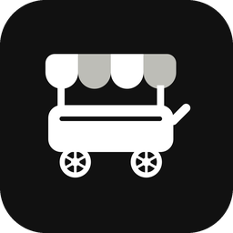

<h1 align="center">Food Cart</h1>

Skip the food court queue: a fast order-ahead mobile app for campus food stalls.

<picture>
  <source media="(max-width: 600px) and (prefers-color-scheme: dark)" srcset="https://shailesh-stats.vercel.app/api/plate?name=repo&amp;repo=food-cart&amp;theme=dark&amp;w=m">
  <source media="(max-width: 600px)" srcset="https://shailesh-stats.vercel.app/api/plate?name=repo&amp;repo=food-cart&amp;theme=light&amp;w=m">
  <source media="(prefers-color-scheme: dark)" srcset="https://shailesh-stats.vercel.app/api/plate?name=repo&amp;repo=food-cart&amp;theme=dark">
  
</picture>
